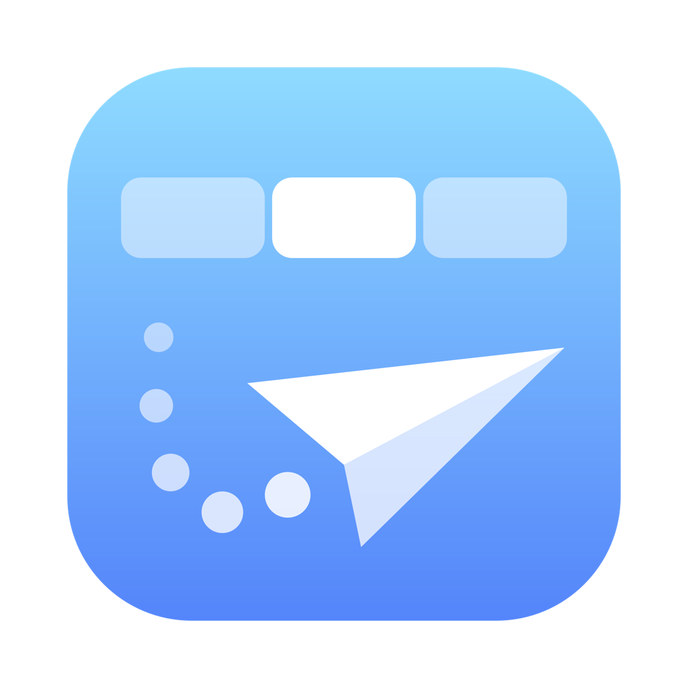

<p align="center">
  
</p>

<h1 align="center">MousePilot</h1>

<p align="center">
  마우스 휠과 제스처로 브라우저를 다루는 macOS 메뉴바 앱
</p>

<p align="center">
  <a href="https://github.com/pms131/MousePilot/releases/latest"></a>
  
  <a href="LICENSE"></a>
</p>

<p align="center">
  <a href="#english">English</a>
</p>

MousePilot은 마우스만으로 브라우저를 다루게 해 줍니다. 리눅스용 크롬처럼 탭바 위에서 휠을 돌려 탭을 바꾸고, 오른쪽 버튼을 누른 채 그어서 뒤로 가기, 탭 닫기, 새로고침 같은 동작을 합니다.

## 기능

- 휠을 **아래로** 돌리면 오른쪽 탭, **위로** 돌리면 왼쪽 탭으로 갑니다.
- **뒤에 있거나 포커스가 없는 브라우저 창**에서도 동작하고, 창을 앞으로 가져오지 않습니다.
- 일반 창, 전체 화면(메뉴 막대가 내려온 상태 포함), 전체 화면 Split View에서 동작합니다.
- 탭바가 아닌 곳의 스크롤은 건드리지 않습니다.
- 순환 켜고 끄기, 휠 방향 반전을 메뉴에서 고를 수 있습니다.
- **마우스 제스처:** 오른쪽 버튼을 누른 채 그으면 뒤로, 앞으로, 새로고침, 탭 닫기 같은 동작이 실행됩니다. 제스처 16개의 동작은 설정 창에서 바꿀 수 있고, 그리는 선과 동작 이름이 화면에 보입니다.
- Brave, 네이버 웨일, Chrome, Safari, Edge, Vivaldi, Opera, Firefox, Arc를 지원합니다.
- 가볍습니다. 대기 중에는 CPU를 거의 쓰지 않습니다.

## 설치

macOS 13 이상이 필요합니다. Apple Silicon과 Intel을 모두 지원합니다.

1. [Releases](https://github.com/pms131/MousePilot/releases/latest)에서 `MousePilot-x.y.z.dmg`를 받습니다.
2. DMG를 열고 **MousePilot.app**을 **Applications** 폴더로 끌어다 놓습니다. 업데이트할 때도 덮어쓰면 됩니다.
3. MousePilot을 엽니다. 애플 공증을 받지 않은 앱이라 처음에는 열리지 않습니다. **시스템 설정 → 개인정보 보호 및 보안** 맨 아래의 **그래도 열기**를 누르고 다시 엽니다.
4. **손쉬운 사용** 권한을 허용합니다. 메뉴바 아이콘이 선명해지면 동작 중입니다.
5. 뒤쪽 창의 탭바에서 처음 휠을 돌리거나 ↓← 제스처(시크릿창에서 열기)를 처음 쓰면, 브라우저마다 자동화 권한을 한 번 묻습니다. **허용**을 누르면 됩니다.

처음 실행할 때 로그인 시 자동 실행도 등록됩니다. 메뉴에서 끌 수 있습니다.

## 사용법

브라우저 탭바 위에 커서를 두고 휠을 돌리면 됩니다. 메뉴바 아이콘을 누르면 다음 메뉴가 나옵니다.

| 메뉴 | 설명 |
|---|---|
| 일시정지 | 잠시 끕니다. 앱을 다시 실행해도 유지됩니다 |
| 순환 (마지막 탭 → 첫 탭) | 끄면 양 끝 탭에서 멈춥니다 |
| 휠 방향 반대로 (위 = 오른쪽 탭) | 휠 방향을 뒤집습니다 |
| 마우스 제스처 | 켜고 끄기, 선·타이틀 표시, 제스처 설정 창 (제스처마다 동작 고르기) |
| 적용 브라우저 | 브라우저별로 켜고 끄기, 설정 파일 열기 |
| 로그인 시 자동 실행 | 켜고 끄기 |
| 로그 폴더 열기… | `~/Library/Logs/mousepilot.log`가 있는 폴더 |

### 마우스 제스처

브라우저 창 위에서 오른쪽 버튼을 누른 채 아래 모양으로 긋고 버튼을 놓습니다.

| 제스처 | 동작 | 제스처 | 동작 |
|:-:|---|:-:|---|
|  | 이전 페이지 |  | 새 창 열기 |
|  | 다음 페이지 |  | 새 탭 열기 |
|  | 맨 위로 |  | 시크릿창에서 열기 |
|  | 맨 아래로 |  | 탭 닫기 |
|  | 홈페이지로 |  | 전체화면 |
|  | 홈페이지로 |  | 닫은 탭 다시 열기 |
|  | 새로고침 |  | 창 최대화 |
|  | 새로고침 |  | 창 최소화 |

- 긋지 않고 오른쪽 클릭만 하면 원래 우클릭 메뉴가 뜹니다. 메뉴는 버튼을 놓을 때 뜹니다.
- 포커스가 없는 창에서 제스처를 하면 그 창을 앞으로 가져온 뒤 실행합니다.
- ↑ 맨 위로·↓ 맨 아래로는 커서 아래의 페이지를 스크롤하고, 커서는 그 자리에 둡니다. 동영상 플레이어에 포커스가 있어도 페이지가 움직입니다. 커서가 채팅 창처럼 따로 스크롤되는 영역 위에 있으면 그 영역이 스크롤됩니다.
- 메뉴의 **마우스 제스처 → 제스처 설정**에서 제스처마다 동작을 고를 수 있습니다. 설정은 `~/.config/mousepilot/gestures`에 저장됩니다.
- 자체 마우스 제스처가 있는 브라우저(Vivaldi, Opera 등)에는 적용하지 않습니다.

### 설정 파일

`~/.config/mousepilot/browsers`에 적용할 브라우저와 탭바 위치를 적습니다. 처음 실행할 때 설치된 브라우저로 만들어지고, 고치면 바로 적용됩니다.

```
# <번들 ID> [탭바 높이 | 시작 끝]   창 맨 위에서 잰 pt, 기본값 0~40
com.brave.Browser
com.naver.Whale
com.google.Chrome
com.apple.Safari 50 88
```

숫자 하나는 탭바 높이, 두 개는 탭바의 시작과 끝입니다. 전체 화면에서도 같은 값을 씁니다.

### 명령줄 도구 (선택)

저장소의 `scripts/mousepilotctl`을 PATH에 두면 터미널에서도 관리할 수 있습니다.

```
mousepilotctl status | on | off | restart
mousepilotctl list | add <브라우저> [높이 | 시작 끝] | remove <브라우저>
mousepilotctl height [pt] | debug on|off | log [줄 수] | uninstall
```

`<브라우저>`에는 brave, whale, chrome, safari, edge, firefox, arc, vivaldi, opera 또는 번들 ID를 씁니다.

## 자주 묻는 질문

**탭이 순서대로 넘어가지 않아요.**
Chromium 계열 브라우저 설정에서 "**Ctrl-Tab으로 최근 사용한 탭 순환**"을 끄세요. 앞에 있는 창은 Ctrl+Tab으로 탭을 바꾸기 때문에, 이 설정이 켜져 있으면 최근 사용한 순서로 이동합니다.

**아무 반응이 없어요.**
메뉴 맨 위에 "손쉬운 사용 권한 필요"가 보이면 **손쉬운 사용 설정 열기**를 눌러 MousePilot을 켜세요. 이미 켜져 있는데도 그렇다면 목록에서 MousePilot을 −로 지우고 다시 추가하세요.

**뒤쪽 창에서는 동작하지 않아요.**
뒤쪽 창은 브라우저의 AppleScript 명령으로 탭을 바꾸므로 자동화 권한이 필요합니다. 거부했다면 **적용 브라우저 → 자동화 권한 설정 열기**에서 허용하세요. Firefox와 Arc는 이 명령이 없어서 앞에 있는 창에서만 동작합니다.

**순환을 끄니 앞에 있는 창에서도 자동화 권한을 물어요.**
Ctrl+Tab은 항상 순환하기 때문에, 순환을 끄면 앞에 있는 창도 AppleScript 명령으로 탭을 바꿉니다. Firefox와 Arc는 순환을 꺼도 순환합니다.

**탭바가 아닌 곳에서 탭이 바뀌거나, 탭바 위에서 반응이 없어요.**
설정 파일에서 그 브라우저의 탭바 구간을 맞추세요. `mousepilotctl debug on`을 켜고 휠을 돌리면 `mousepilotctl log`에 창 맨 위에서의 거리가 찍힙니다. 디버그 로그는 모든 스크롤 위치를 기록하므로 다 쓰면 `mousepilotctl debug off`로 끄세요.

**제스처를 쓰면 우클릭 메뉴가 늦게 떠요.**
제스처인지 우클릭인지는 버튼을 놓아야 알 수 있어서, 우클릭 메뉴가 버튼을 놓을 때 뜹니다. 오른쪽 버튼 드래그를 쓰는 웹 앱(지도, 그림 도구 등)에서는 메뉴의 **마우스 제스처 → 사용하기**를 잠시 끄세요.

**확장 프로그램으로 만들 수는 없나요?**
Chromium에는 이 기능이 이미 들어 있지만(`kScrollEventChangesTab`) 리눅스 빌드에서만 켜집니다. 확장 프로그램은 탭바 위의 휠 입력을 받을 수 없어서, MousePilot이 OS 수준에서 휠 입력을 받아 처리합니다.

## 알려진 한계

- 애플 공증을 받지 않아 처음 열 때 경고가 뜹니다.
- 세로 탭(사이드 탭)은 지원하지 않습니다.
- Safari의 탭바 구간 `50 88`은 기본 레이아웃 기준입니다. 탭이 하나뿐이라 탭바가 숨겨졌거나 컴팩트 레이아웃을 쓰면 페이지 위쪽에서 탭이 바뀔 수 있습니다. 설정 파일에서 구간을 맞추거나 Safari를 끄세요.
- 같은 브라우저 창 여러 개가 크기와 제목까지 같으면, 뒤쪽 창에서 다른 창의 탭이 바뀔 수 있습니다.
- 제스처를 쓰지 않을 사이트를 정하는 기능은 없습니다.
- 제스처의 "시크릿창에서 열기"로 지금 페이지를 여는 것은 Brave, Chrome, Edge에서만 됩니다. Safari, Firefox, Arc에서는 빈 시크릿(개인정보 보호) 창이 열립니다.

## 삭제

메뉴에서 **로그인 시 자동 실행**을 끄고 **MousePilot 종료**를 누른 뒤, 응용 프로그램 폴더의 MousePilot을 휴지통으로 옮깁니다. **시스템 설정 → 개인정보 보호 및 보안**의 손쉬운 사용·자동화 목록에서도 MousePilot을 지우세요. 설정과 로그까지 지우려면:

```
defaults delete com.pms.mousepilot
rm -r ~/.config/mousepilot ~/Library/Logs/mousepilot.log
```

`mousepilotctl uninstall`은 권한 목록 정리를 뺀 나머지를 한 번에 합니다.

## 직접 빌드

Xcode Command Line Tools(`xcode-select --install`)가 필요합니다.

```
git clone https://github.com/pms131/MousePilot.git
cd MousePilot
scripts/build.sh --install   # 빌드한 뒤 /Applications에 설치하고 실행
```

`--dmg`를 붙이면 `dist/`에 DMG를 만듭니다. 처음 빌드할 때 서명용 키체인을 만들면서 새 암호를 묻습니다. `--adhoc`으로 빌드하면 암호를 묻지 않지만, 빌드할 때마다 손쉬운 사용 권한을 다시 허용해야 합니다.

## 라이선스

[MIT](LICENSE)

---

## English

MousePilot switches browser tabs when you scroll the mouse wheel over the tab strip, the way Chrome does on Linux. Wheel down goes to the next tab, wheel up to the previous one. It also works on background and unfocused windows without bringing them forward, in full screen and in full-screen Split View. Supports Brave, Whale, Chrome, Safari, Edge, Vivaldi, Opera, Firefox and Arc on macOS 13 or later.

**Install:** download the DMG from [Releases](https://github.com/pms131/MousePilot/releases/latest) and drag MousePilot.app to Applications. Open it, click *Open Anyway* in System Settings → Privacy & Security (the app is not notarized), and grant Accessibility access. The first scroll over a background window, or the first ↓← gesture (open the page in an incognito window), asks once per browser for Automation permission.

**Mouse gestures:** hold the right button over a browser window and draw one or two strokes: left = back, right = forward, down then right = close tab, and so on — 16 gestures, with a trail and the action's name on screen. Up and down scroll the page under the pointer to the top or bottom, even while a video player has the focus. *Gesture settings…* in the menu shows each gesture's shape and lets you pick its action. Browsers with mouse gestures of their own (Vivaldi, Opera, …) keep them.

**Tips:** the menu bar icon lets you pause, stop at the first and last tab instead of wrapping around, reverse the wheel direction and choose browsers. If tabs cycle in an odd order, turn off Chromium's *"Cycle through the most recently used tabs with Ctrl-Tab"*. Tab strip positions can be adjusted in `~/.config/mousepilot/browsers`.
